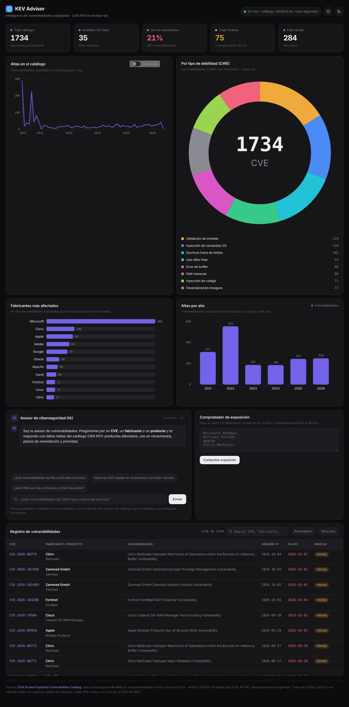

# KEV Advisor

Panel de **inteligencia de vulnerabilidades en tiempo real** sobre el catálogo oficial
**CISA KEV** (Known Exploited Vulnerabilities), con un **asesor de ciberseguridad por IA**
anclado a los datos reales del catálogo.

No es una instantánea: el backend descarga el catálogo **en vivo** desde el feed oficial
de CISA cada vez que se refresca, y el asesor IA responde únicamente a partir de los
registros reales que recupera del catálogo.



## Qué hace

- **Panel en vivo**: KPIs, altas por mes (acumulado/mensual), distribución por CWE,
  fabricantes más afectados y estado de remediación según los plazos BOD de CISA.
- **Comprobador de exposición**: pegas tu stack (fabricantes/productos) y te dice qué
  KEVs te afectan, ordenadas por uso en ransomware y plazo.
- **Asesor IA (defensivo)**: preguntas por un CVE, fabricante o producto y responde con
  datos reales — productos afectados, ransomware, prioridad y remediación — citando CVE
  y enlace a la NVD. No genera exploits.
- **Modo claro y oscuro**.

## Arquitectura

```
Navegador ──▶ /api/kev      ──▶ backend ──▶ feed oficial CISA (caché 1h)
          ──▶ /api/advisor  ──▶ backend ──▶ OpenRouter (la API key vive solo aquí)
```

El navegador **nunca** ve la API key ni llama a servicios externos: todo pasa por el
backend (buena práctica de seguridad y evita problemas de CORS).

## Requisitos

- Node.js 18 o superior.

## Puesta en marcha

```bash
npm install
cp .env.example .env     # (en Windows: copy .env.example .env)
```

Edita `.env`. Por defecto usa **Groq** (gratis, muy rápido, responde en español sin
cuelgues):

1. Entra en <https://console.groq.com/keys> y crea una cuenta gratuita.
2. Genera una API key y pégala en `GROQ_API_KEY` (en una sola línea, sin comillas).
3. El modelo por defecto es `llama-3.3-70b-versatile` (con `llama-3.1-8b-instant` de
   respaldo automático si el primero no estuviera disponible).

¿Prefieres OpenRouter? Pon `LLM_PROVIDER=openrouter` y rellena `OPENROUTER_API_KEY`
(con `OPENROUTER_MODEL=auto` el servidor elige solo un modelo gratuito disponible).

Arranca:

```bash
npm run dev
```

Abre <http://localhost:3000>.

> El panel y el comprobador de exposición funcionan **sin** clave; solo el asesor IA la
> necesita. Sin `.env`, el asesor muestra un aviso con instrucciones en lugar de romperse.

## Endpoints

| Método | Ruta           | Descripción                                             |
|--------|----------------|---------------------------------------------------------|
| GET    | `/api/kev`     | Catálogo KEV en vivo (`?refresh=1` fuerza revalidación) |
| POST   | `/api/advisor` | Pregunta al asesor IA (`{ "question": "..." }`)         |
| GET    | `/api/health`  | Estado del servicio y si el asesor está configurado     |

## Fuentes de datos

- Catálogo: **CISA Known Exploited Vulnerabilities** — feed oficial, con respaldo en el
  repositorio oficial `cisagov/kev-data`.
- Cada CVE enlaza a su ficha en la **NVD del NIST**.

## Nota ética

El asesor está deliberadamente orientado a la **defensa** (priorización, parcheo,
detección y remediación). No proporciona código de explotación ni pasos ofensivos.
La información es orientativa y no sustituye una evaluación profesional.
